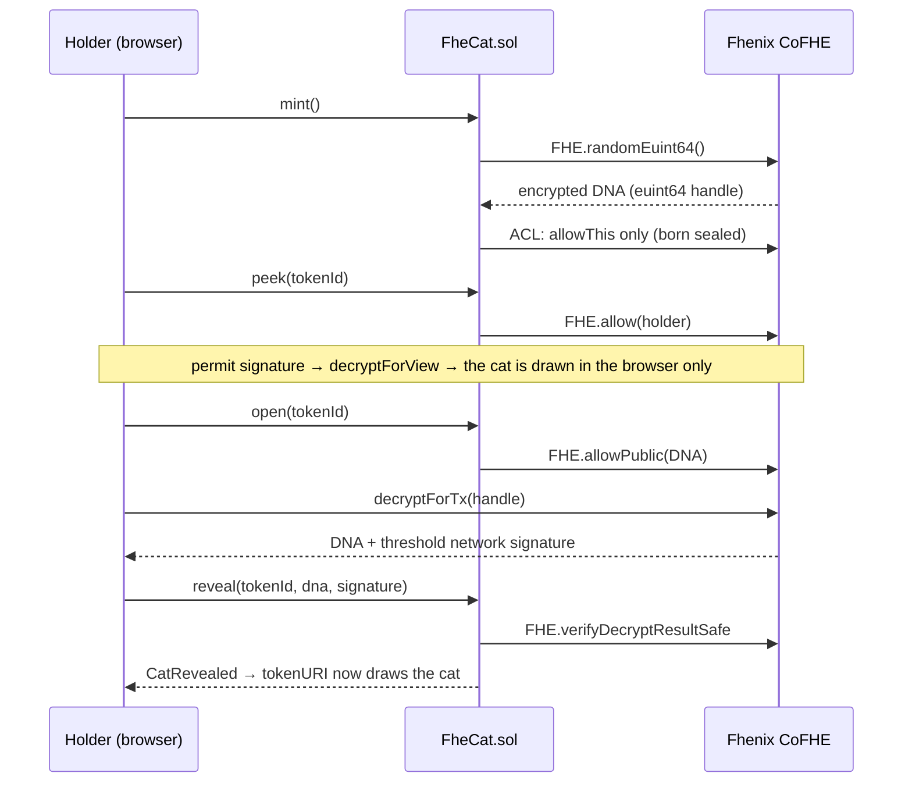

<p align="center">
  
</p>

<h1 align="center">FheCat</h1>

<p align="center">
  <b>Pixel cats, born encrypted.</b><br />
  An on-chain NFT collection whose DNA is drawn and kept encrypted with Fhenix FHE, plus a blind PvP arena.
</p>

<p align="center">
  <a href="https://fhecat.com">Website</a> ·
  <a href="https://fhecat.com/testnet/">Try the testnet</a> ·
  <a href="https://x.com/FheCat">X / Twitter</a>
</p>

---

## Overview

Every FheCat gets a 64-bit DNA from `FHE.randomEuint64()` the moment it is minted, and is born in a sealed box. The DNA only exists as a ciphertext: nobody can decrypt it, not the team, not the minter, not a bot. Rarity sniping is impossible because nobody can know the traits at mint time.

What happens to the box is up to its holder alone. Keep it sealed, **peek** in private, or **open** it for everyone. Nothing forces a reveal, and a cat may stay sealed forever. Art and metadata are rendered fully on-chain.

The **Blind Arena** lets holders fight with their cats while they are still sealed: tactics are encrypted in the browser, the fight is scored under FHE, and only the winner is ever made public.

| | |
|---|---|
| Supply | 4,444 |
| Chain | Arbitrum One (mainnet), Arbitrum Sepolia (testnet) |
| Standards | ERC-721, ERC-2981 (5% royalty), ERC-4906 |
| Art | 32×32 pixel SVG, rendered on-chain; 8 traits, 93 options |
| Encryption | [Fhenix CoFHE](https://cofhe-docs.fhenix.zone/) |

<p align="center"></p>

## Fhenix is a coprocessor, not a chain

FheCat contracts live on **Arbitrum**. Fhenix CoFHE is an FHE coprocessor that plugs into existing EVM chains: the contracts import Fhenix's Solidity library, each encrypted operation is recorded by Fhenix's TaskManager contract on the same chain, the computation runs off-chain in the coprocessor, and Fhenix's threshold network decrypts only for whoever is allowed. Tokens, balances and gas all stay on Arbitrum; minting needs nothing but ETH.

| Layer | Where | Role |
|---|---|---|
| FheCat, FheCatArena, FheCatRenderer | Arbitrum | NFTs, game logic, on-chain art |
| TaskManager + ACL | Arbitrum (Fhenix contract) | Records FHE tasks and who may use each ciphertext |
| CoFHE coprocessor | Off-chain (Fhenix) | Computes on ciphertexts |
| Threshold network | Off-chain (Fhenix) | Decrypts for authorized parties and signs the result |
| Browser | User | Encrypts inputs, decrypts the holder's own data, draws the cat |

Arbitrum Sepolia is Arbitrum One's test network, so the testnet deployment is a one-to-one rehearsal of mainnet: same contracts, same settings, same site.

## How it works



| State | Meaning | Who can decrypt |
|---|---|---|
| **Unopened** | Nobody has ever seen the cat (provable on-chain). | Nobody, not even the holder |
| **Peeked** | The holder decrypted it privately. The flag is permanent, so buyers know. | Only the wallet that peeked |
| **Opened** | The holder made the DNA publicly decryptable. | Everyone |
| **Revealed** | The DNA is written on-chain and the cat is drawn. | Everyone |

- Peek adds the holder to the ciphertext's ACL. The holder signs a free EIP-712 permit and decrypts with `decryptForView`; the DNA never leaves the browser. ACL grants cannot be revoked, which is why the Peeked flag is permanent.
- Reveal submits the threshold network's signed decryption, checked by `FHE.verifyDecryptResultSafe`. Anyone can reveal an Opened cat; a holder who peeked can reveal with their own proof. Forged DNA and another cat's proof are rejected.
- The team cannot decrypt any DNA or open anyone's cat. It can only swap the renderer (the image) and the arena address.

## Blind Arena

*You don't need to see your cat to become a legend.*

- Three tactics: Pounce beats Trick, Trick beats Guard, Guard beats Pounce. Each tactic is encrypted in the player's browser (`encryptInputs`) and bound by the CoFHE verifier's signature to that wallet and this arena. Before the fight nobody can see it; afterwards only the two players can.
- Hidden instincts: every cat has a 0–2 instinct per tactic, computed under FHE from its encrypted traits (Pounce: pattern + eyes, Trick: mouth + headwear, Guard: accessory + aura). Rare traits give a small edge.
- Score = 2 if the tactic wins + instinct (0–2) + encrypted luck (0–1). A sealed box wins ties. Only the result (challenger or opponent) is made public; DNA, tactics, instincts and scores stay encrypted. The right tactic wins about 92–95% of duels.
- Peeking is a game decision: it shows your instincts, but the cat is marked Peeked for good and loses the sealed advantage.
- Weekly table: win 3 points, sealed win 4, loss 1. Weeks start Monday 00:00 UTC; two cats meet at most once a week; a challenge stays open 3 days. Badges stay with the cat: First Blood, Won Blind, Hat-trick, Sealed Legend, Weekly Crown.
- Tier proofs: `claimTier` proves a cat reaches Rare (≥1200 power, ~20%), Epic (≥1350, ~6%), Legendary (≥1500, ~1%) or Mythic (≥1600, ~0.2%) without revealing anything else. Power is the sum of the DNA's 8 bytes.
- Watchable fights: every cat has a full-body pixel fighter; a sealed cat fights as its own barcoded box. Fights play live with per-tactic choreography, chiptune music and an announcer, and every result can be replayed.

Nothing is staked: no cat changes hands, there are no prizes or fees beyond gas.

## Fhenix integration

A summary for reviewers of how FheCat uses CoFHE. Built against the stable releases: `@fhenixprotocol/cofhe-contracts` 1.0.1 (TaskManager resolved through the CoFHEAddressBook) and `@cofhe/sdk` 1.0.0.

**Encrypted state and who is on each ACL**

| Ciphertext | Type | Created by | ACL |
|---|---|---|---|
| Cat DNA | `euint64` | `FHE.randomEuint64()` at mint | FheCat (`allowThis`); the holder after `peek` (`allow`); the arena after `enterArena` (`allow`); everyone after `open` (`allowPublic`) |
| Arena tactic | `euint8` | `FHE.asEuint8(externalEuint8, proof)`: an input encrypted in the browser, verified for that wallet and the arena | Arena; its player; the rival after the fight |
| Instincts, power | `euint64` | Derived from the DNA once per cat (`and`, `shr`, `add`) | Arena only |
| Duel luck | `euint64` | `FHE.randomEuint64()` per fight | Arena only |
| Duel outcome | `euint64` | `gt`, `select` on both scores | Arena; public (`allowPublic`) |
| Tier answer | `ebool` | `FHE.gte(power, threshold)` | Arena; public (`allowPublic`) |

**FHE operations used:** `randomEuint64`, `asEuint8` (verified input), `asEuint64` (trivial constants, cached), `and`, `shr`, `shl`, `add`, `lt`, `gt`, `gte`, `select`, `allow`, `allowThis`, `allowPublic`, `isAllowed`, `verifyDecryptResultSafe`.

**Decryption paths**
- Private: the holder signs a self ACP (EIP-712) and calls `decryptForView`; plaintext stays in the browser (peek, instincts, both tactics after a fight).
- Public: `decryptForTx(...).withoutACP()` on a handle made public with `allowPublic`; the plaintext and the threshold network's signature go back on-chain and are checked with `FHE.verifyDecryptResultSafe` (reveal, duel settle, tier settle). Wrong values and signatures for another handle are rejected.

Nothing else is ever decrypted: no ciphertext the contracts hold is made public except a revealed cat's DNA, a duel's winner and a tier answer. Constructors make no FHE calls. Contracts calling FHE: `FheCat`, `FheCatArena` (the renderer does not).

**Verified on:** the CoFHE mocks (55 contract tests, 6 browser tests), forks of the live Arbitrum Sepolia TaskManager (`npm run test:fork`), and the live Arbitrum Sepolia deployment through the site, including encrypted arena inputs and threshold network decryptions.

## Collection

- 8 traits, 93 options: background (10), fur (12), pattern (10), eyes (16), mouth (10), headwear (16), accessory (12), aura (7). Each DNA byte picks one trait; rarity weights are public and fixed in the contract (`art/src/traits.ts`).
- On-chain art: `FheCatRenderer` draws 32×32 SVGs. The site renders with an identical TypeScript renderer and tests enforce byte-for-byte parity, so a private peek never leaves the browser.
- Every sky is different: each revealed cat has 4 stars picked from its whole DNA.
- Sealed boxes: unrevealed cats show a box per state, with a barcode derived from the cat's own ciphertext handle.

## Repository

```
art/         Sprites, trait tables, the TypeScript SVG renderer (source of truth), arena fighters and rules
contracts/   Hardhat: FheCat.sol, FheCatRenderer.sol, FheCatArena.sol, generated FheCatArt.sol, tests, deploy and admin tasks
web/         Mint site: Vite + React 19 + wagmi 3 + @cofhe/sdk, Playwright end-to-end tests
landing/     fhecat.com: static site, waitlist, collab and admin (Vercel functions + Postgres)
tools/       Pixel font generator for the landing page
```

Stack: Solidity 0.8.28 (cancun), OpenZeppelin 5.4, `@fhenixprotocol/cofhe-contracts` 1.0.1, `@cofhe/sdk` and `@cofhe/hardhat-plugin` 1.0.0, Node.js 20+ (22 recommended).

## Getting started

```bash
cd contracts && npm install && npm test   # 55 tests against the CoFHE mocks
cd ../web && npm install
bash e2e/stack.sh                          # local chain + CoFHE mocks + deploy + site
# open http://localhost:5173 → Connect wallet → Dev wallet
```

- `npm run test:e2e` (in `web/`): mint → peek → reveal, opening a box, a blind duel between two wallets with its live fight and replays, every fight choreography, the admin's arena view and the owner panel.
- `npm run test:fork` (in `contracts/`): runs the production contract against the live CoFHE TaskManager on a fork of a testnet (`FORK=arb-sepolia`, `base-sepolia`, `eth-sepolia`) or mainnet (`FORK=arbitrum`). Nothing is sent to the real chain.

CoFHE mocks cannot produce encrypted randomness, so the local chain deploys `FheCatLocal` and `FheCatArenaLocal`, which replace only the random draw. They refuse to deploy to any chain other than 31337. The real `FHE.randomEuint64()` path is covered by the fork tests and the testnet.

To change the art, edit `art/src/sprites/*`, then regenerate the on-chain library with `cd contracts && npm run art:sol` (CI checks it is up to date). `npm run art:preview` writes a sample gallery.

## Networks

| Network | Chain ID | Hardhat network | Status |
|---|---|---|---|
| Arbitrum Sepolia | 421614 | `arb-sepolia` | Live (default) |
| Base Sepolia | 84532 | `base-sepolia` | Supported |
| Ethereum Sepolia | 11155111 | `eth-sepolia` | Supported |
| Arbitrum One | 42161 | `arbitrum` | Mainnet target |
| Ethereum | 1 | `ethereum` | Supported |

FHE.sol finds the TaskManager through the CoFHEAddressBook (`0xC0F4e00E531a2B086492Ae3DCC1515038307196b`), which lives at the same address on every chain.

**Testnet deployment (Arbitrum Sepolia)**

| Contract | Address |
|---|---|
| FheCat | [`0xd4F8521c8F4dBd22fe8E0877beF1Fd91A0691b24`](https://sepolia.arbiscan.io/address/0xd4F8521c8F4dBd22fe8E0877beF1Fd91A0691b24) |
| FheCatRenderer | [`0x363fF5772cfA089e2A16D64a27087Ff54fC02F0C`](https://sepolia.arbiscan.io/address/0x363fF5772cfA089e2A16D64a27087Ff54fC02F0C) |
| FheCatArena | [`0x2c72A0cdBB5685A0461989964C9574eAc202c2c7`](https://sepolia.arbiscan.io/address/0x2c72A0cdBB5685A0461989964C9574eAc202c2c7) |

**Measured gas (Arbitrum Sepolia, real CoFHE):** mint ≈174k, peek ≈106k, open ≈88k, reveal ≈62k, transfer ≈43k, enter arena ≈85k, challenge ≈0.6–1.0M, accept and fight ≈1.7–2.3M, settle ≈211k. A whole duel cost about 0.0003 ETH at 0.09 gwei. There is no separate FHE fee.

## Deployment

Collection settings live in `contracts/launch.json` and are shared by testnet and mainnet: name, supply (4444), price (0.00115 ETH), 3 per wallet per phase, 5% royalty. The deployer key is read from the `PRIVATE_KEY` environment variable (or `contracts/.env`, which is git-ignored).

```bash
cd contracts
npm run deploy:arb-sepolia                       # writes contracts/deployments/<network>.json and web/src/config/deployments.json
npx hardhat fhecat:allowlist allowlist/arb-sepolia.txt --network arb-sepolia
npx hardhat fhecat:phase allowlist --network arb-sepolia
```

If `owner` in `launch.json` differs from the deployer, ownership is offered to it and accepted from the site's Owner panel (Ownable2Step). Every owner action is also available in that panel.

**Mainnet checklist**

1. Fhenix must allow the contracts on mainnet: the mainnet TaskManager can restrict FHE calls to an access list. `FheCat` and `FheCatArena` call FHE; the renderer does not. Constructors make no FHE calls, so the contracts can be deployed first and their addresses shared.
2. `FORK=arbitrum npm run test:fork` passes (it reports `CofheIsUnavailable` or `NotOnAccessList` otherwise).
3. Update the price in `launch.json`, then `CONFIRM_MAINNET=yes npm run deploy:arbitrum` with `PRIVATE_KEY`, `ETHERSCAN_API_KEY` and `ARBITRUM_RPC_URL` set. Prefer a fresh deployer wallet and a Safe as `owner`.
4. Build the allowlist, write it with `fhecat:allowlist <file> --write-only`, commit `deployments.json` and `allowlist.json`, publish the site, then set the root from the Owner panel.
5. Open the sale: Allowlist, then Public. OpenSea indexes Arbitrum One collections automatically; reveals emit `MetadataUpdate` (ERC-4906).

## Admin tasks

All tasks run in `contracts/` with `--network <name>`.

| Task | Description |
|---|---|
| `fhecat:status` | Phase, supply, prices, limits, cats per state, arena, balance |
| `fhecat:phase closed\|allowlist\|public` | Set the sale phase |
| `fhecat:prices --public 0.001 --allowlist 0` | Set mint prices (ETH) |
| `fhecat:limits --public 3 --allowlist 2` | Per-wallet limits (0 = unlimited) |
| `fhecat:allowlist addresses.txt` | Set the Merkle root and write `web/public/allowlist.json` |
| `fhecat:airdrop --to 0x… --quantity 5` | Mint from the team reserve (≤10 per call) |
| `fhecat:peek 12` / `fhecat:reveal 12` | Peek at or reveal a cat you hold |
| `fhecat:withdraw --to 0x…` | Withdraw mint proceeds |
| `fhecat:arena 0x…` / `arena:deploy` | Point FheCat at an arena / deploy a new one |
| `arena:enter 12` | Enter a cat into the arena |
| `arena:duel 12 --tactic guard [--opponent 40]` | Challenge with an encrypted tactic |
| `arena:accept 3 40 --tactic trick` | Accept a duel and settle it |
| `arena:settle 3` / `arena:tier 12 2` / `arena:status [12]` | Settle, prove a tier, show records |

## Websites

- Mint site (`web/`): static Vite build (`npm run build`). No analytics; it only talks to the chain's RPC and Fhenix's services. `npm run build:testnet-copy` writes the public testnet copy served at [fhecat.com/testnet](https://fhecat.com/testnet/); `npm run build:admin-copy` writes the copy behind the admin sign-in.
- fhecat.com (`landing/`): plain HTML/CSS/JS on Vercel, with a waitlist (X post + wallet, reviewed by hand), a collab flow for communities (wallet sign-in, raffle winners, optional AlphaBot link) and an admin panel. Server functions need `DATABASE_URL` (Postgres) and `ADMIN_PASSWORD`; tables are created on first use.

## Security

- Not audited. The contracts are tested but have not been independently audited. Use at your own risk.
- Not upgradeable. The owner can change prices, limits, phase, allowlist root, royalty, renderer and arena address, and withdraw proceeds. The owner cannot read or change any DNA.
- Fhenix dependency: minting, peeking, opening and the arena need CoFHE. Transfers and on-chain images do not.
- Royalties (ERC-2981) are informational; marketplaces may not enforce them.
- Testnet tokens have no monetary value.

## License

[MIT](LICENSE)
