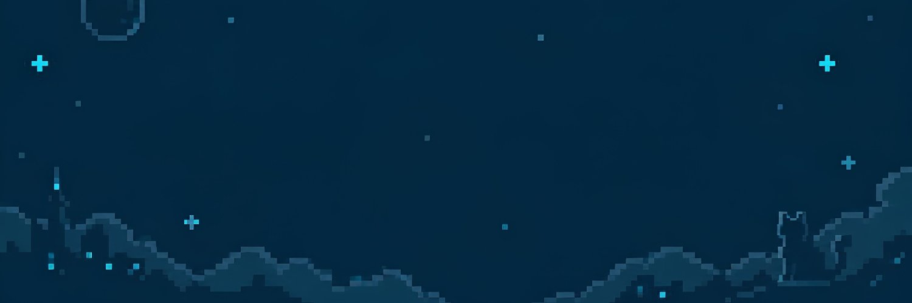
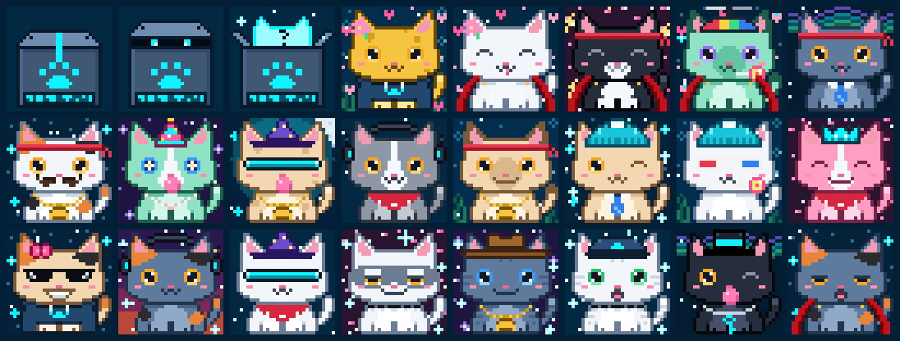
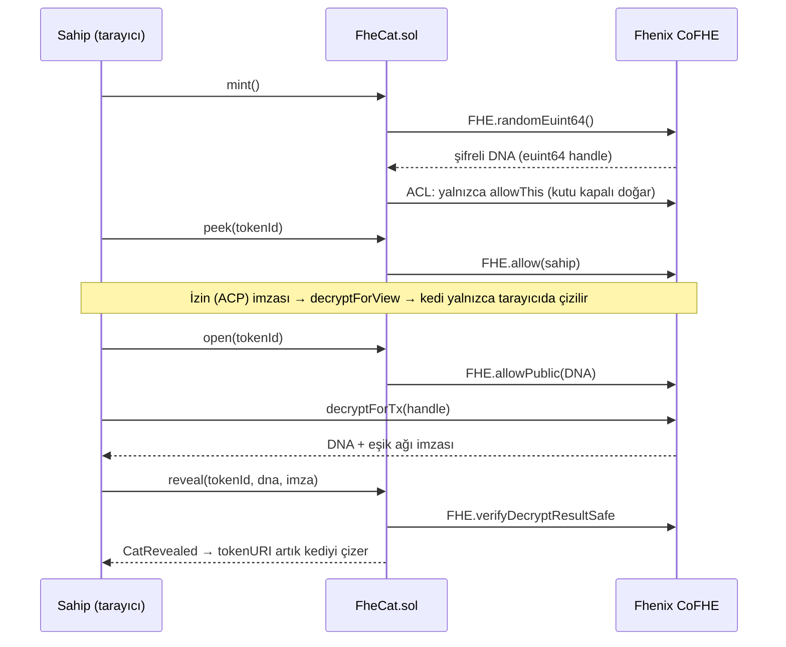

<p align="center">
  
</p>

# FheCat 🐾

**Şifreli doğan piksel kediler.** Fhenix CoFHE üzerinde çalışan bir NFT koleksiyonu. X: [@FheCat](https://x.com/FheCat)

Her FheCat, mint anında DNA'sını Fhenix'in **FHE (tam homomorfik şifreleme) rastgeleliğinden** alır ve kapalı bir kutuda doğar: DNA zincirde yalnızca şifreli (ciphertext) olarak durur ve kimse çözemez. Ne ekip, ne mintleyen kişi, ne de botlar. Kutu hakkında karar yalnızca sahibinindir: kapalı tutabilir, gizlice bakabilir (**Peek**) ya da herkese açabilir (**Open**). Açılan kedi, Fhenix eşik ağının (threshold network) imzalı şifre çözme kanıtıyla zincirde reveal edilir. Hiçbir şey reveal'ı zorlamaz; bir kedi sonsuza dek kapalı kalabilir. Görseller ve metadata **tamamen zincir üzerinde** üretilir.

<p align="center"></p>

- [Nasıl çalışır](#nasıl-çalışır)
- [Koleksiyon](#koleksiyon)
- [Ağlar](#ağlar)
- [Hızlı başlangıç (yerel)](#hızlı-başlangıç-yerel)
- [Testnet'e yayınlama](#testnete-yayınlama)
- [Yönetim komutları](#yönetim-komutları)
- [Mint sitesini yayınlama](#mint-sitesini-yayınlama)
- [Güvenlik notları ve sınırlamalar](#güvenlik-notları-ve-sınırlamalar)
- [Proje yapısı](#proje-yapısı)
- [English summary](#english-summary)

## Nasıl çalışır



1. **Kör mint.** `mint()` her kedi için `FHE.randomEuint64()` çağırır. Şifreli DNA'nın erişim listesinde (ACL) yalnızca kontrat vardır: kedi **Unopened** doğar ve kimse çözemez, sahibi bile. Nadirlik avcılığı yapılamaz, çünkü özellikler mint anında kimse tarafından bilinemez.
2. **Peek (gizli bakış).** Sahip `peek()` çağırır ve kontrat onu ACL'e ekler (`FHE.allow`). Sahip ücretsiz bir EIP-712 izni (ACP) imzalar; DNA `decryptForView` ile yalnızca onun tarayıcısında çözülür ve hiçbir yere yayınlanmaz. Kedi kalıcı olarak **Peeked** işaretlenir, böylece alıcılar kedinin görülmüş olabileceğini bilir. Satıştan sonra yeni sahip kendisi peek etmelidir.
3. **Open.** Sahip `open()` ile DNA'yı herkese çözülebilir yapar (`FHE.allowPublic`). Kedi **Opened** olur ve reveal'ı artık herkes tamamlayabilir.
4. **Reveal.** Eşik ağı DNA'yı çözer ve imzalar. `reveal()` bu imzayı `FHE.verifyDecryptResultSafe` ile doğrular ve kedi **Revealed** olur. Opened bir kediyi herkes, Peeked bir kediyi ise sahibi kendi kanıtıyla reveal edebilir. Kontrat sahte bir DNA'yı ve başka bir kedinin kanıtını reddeder.

Hiçbir şey reveal'ı zorlamaz. Ekip dahil kimse başkasının kedisini açamaz ve büyük bir reveal tarihi yoktur. Bir kedi sonsuza dek kapalı kalabilir.

### Arena: kör düellolar ve kademe kanıtları

`FheCatArena`, kediler kapalıyken bile onlarla oynamayı sağlar. Bir kedinin **Gücü**, DNA'sının 8 baytının toplamıdır (0–2040). Her özellik tablosu en yaygından en nadire sıralı olduğu için daha nadir bir özellik her zaman en az o kadar güç demektir. Arena Gücü FHE ile şifreli hesaplar ve hiçbir zaman çözmez. Herkese açılan tek şey, sahibin sorduğu tek bitlik cevaptır:

- **Kör düello:** `challenge(kedim, rakip)` (rakip 0 ise herkese açık) → rakip kedinin sahibi `accept()` → arena `FHE.gt(güçA, güçB)` sonucunu herkese çözülebilir yapar → herkes eşik ağının kanıtıyla `settle()` eder. Yalnızca kazanan açıklanır; eşitlikte savunan kazanır. Kazanma/kaybetme sayıları zincirde tutulur. Ortada ödül yoktur, sadece şan.
- **Kademe kanıtı:** `claimTier(kedim, kademe)` → arena `FHE.gte(güç, eşik)` sonucunu açar → `settleTier()`. Kademeler: Rare ≥1200 (en iyi ~%20), Epic ≥1350 (~%6), Legendary ≥1500 (~%1), Mythic ≥1600 (~%0,2). Cevap evet de olsa hayır da olsa herkese açık olur; DNA, özellikler ve Gücün kendisi kapalı kalır.

Oynamak için sahip önce `FheCat.enterArena()` ile arenanın kedisinin şifreli DNA'sı üzerinde hesap yapmasına izin verir. Bir kediyle düello açmayı, kabul etmeyi veya kademe istemeyi yalnızca o anki sahibi yapabilir. Bir kedinin Gücü ilk oyununda bir kez hesaplanır ve şifreli olarak saklanır; onu kimse çözemez, arena dahil.

## Koleksiyon

- **8 özellik, 93 seçenek:** Arka plan (10), Kürk (12), Desen (10), Gözler (16), Ağız (10), Başlık (16), Aksesuar (12), Aura (7).
- DNA 64 bittir ve her bayt bir özelliği seçer. Nadirlik ağırlıkları herkese açıktır ve kontratta sabittir (her tablo 256'ya tamamlanır). Tablolar [`art/src/traits.ts`](art/src/traits.ts) dosyasında.
- En nadir seçenekler: Encrypted Aura (%1,6), Cipher Crown (%1,6), Gold kürk (%2,3), Laser Eyes ve Cipher Eyes (%3,1).
- 32×32 piksel SVG görseller `FheCatRenderer` kontratında zincir üzerinde çizilir. Web sitesi de aynı çizimi TypeScript'te yapar; testler iki çıktının **bayt bayt aynı** olduğunu doğrular. Böylece gizli bakışta DNA tarayıcıdan hiç çıkmaz.
- **Her gökyüzü farklı:** Reveal edilen her kedinin arka planında, 64 bitlik DNA'nın tamamından seçilen 4 yıldız vardır. Aynı özellikleri taşıyan iki kedi bile farklı görünür.
- **Kapalı kutular:** Reveal edilmemiş kediler durumlarına göre bir kutu gösterir: Unopened (bantlı kutu), Peeked (aralanmış kapak, karanlıkta iki göz), Opened (açık kutudan yükselen ışık). Etiketteki barkod kedinin kendi şifreli handle'ından türetilir; her kutu farklı görünür ama hiçbir şey sızdırmaz.
- Koleksiyon ayarları [`contracts/launch.json`](contracts/launch.json) dosyasındadır ve testnet provası ile mainnet için aynı dosya kullanılır: arz 4444, kedi başına 0,00115 ETH (≈ 3 $; mainnet deploy'undan önce o günkü kurla güncellenir), her aşamada cüzdan başına 3 kedi, %5 royalty (ERC-2981). Fiyatlar ve limitler deploy'dan sonra sitedeki Owner bölümünden değiştirilebilir.

Sanatı değiştirmek için: `art/src/sprites/*` dosyalarını düzenleyin, ardından `cd contracts && npm run art:sol` ile zincir üstü veri kütüphanesini yeniden üretin. `npm run art:preview` komutu `art/preview/index.html` dosyasına örnek bir galeri yazar.

## Ağlar

Fhenix CoFHE bugün (Ekim 2026) üç **testnet'te** çalışıyor. Fhenix, mainnet'i 21 Ekim'de Ethereum ve Arbitrum One'da açacağını duyurdu:

| Ağ | Chain ID | Hardhat ağı | Durum |
|---|---|---|---|
| Arbitrum Sepolia (varsayılan) | 421614 | `arb-sepolia` | canlı |
| Base Sepolia | 84532 | `base-sepolia` | canlı |
| Ethereum Sepolia | 11155111 | `eth-sepolia` | canlı |
| Arbitrum One | 42161 | `arbitrum` | 21 Ekim, erişim Fhenix'in onayına bağlı |
| Ethereum | 1 | `ethereum` | 21 Ekim, erişim Fhenix'in onayına bağlı |

Kontratlar `@fhenixprotocol/cofhe-contracts` 1.0.0 ile derlenir. Bu sürümde FHE.sol, TaskManager'ı her zincirde aynı adreste duran CoFHEAddressBook (`0xC0F4…196b`) üzerinden bulur. Testnet'lerde bu, eski sabit adrese (`0xeA30…48D9`) çıkar; mainnet'te ise başka bir TaskManager'a (`0x52E7…432A`). 0.2.0 ile derlenen bir kontrat mainnet'te hiç çalışmazdı.

Kontratlar, bu üç testnet'in fork'unda gerçek CoFHE TaskManager ve ACL'e karşı test edildi (`npm run test:fork`). Ölçülen gas değerleri: tek mint ≈174k, üçlü mint ≈413k, peek ≈106k, open ≈105k, transfer ≈60k. Arena: arenaya giriş ≈85k, bir kedinin Gücünün ilk hesaplandığı düello ≈590k–990k, iki Gücü de hazır düello kabulü ≈142k, kademe kanıtı ≈312k. FHE işlemleri zincir dışında yapıldığı için ayrıca FHE ücreti ödenmez.

Aynı test mainnet fork'unda da çalışır (`FORK=arbitrum npm run test:fork`; gerçek zincire hiçbir şey gönderilmez). 6 Ekim itibarıyla mainnet TaskManager mint'i `CofheIsUnavailable()` ile reddediyor, yani CoFHE henüz açılmadı. Ayrıca erişim listesinde olmayan kontratların FHE işlemleri `NotOnAccessList(address)` ile reddediliyor. Lansman günü aynı komut, FheCat'in mainnet'te çalışıp çalışmadığını gösterir. Ayrıntılar: [docs/MAINNET.md](docs/MAINNET.md).

## Hızlı başlangıç (yerel)

Gereksinim: Node.js 20+ (22 önerilir).

```bash
cd contracts && npm install && npm test   # 48 test: mint, kutu durumları, ACL, reveal, arena, metadata, TS↔Solidity render birebirliği
cd ../web && npm install
bash e2e/stack.sh                          # Hardhat + CoFHE mock'ları + yerel deploy + site
# http://localhost:5173 → "Cüzdan bağla" → "Geliştirici cüzdanı"
```

- `npm run test:e2e` (web klasöründe): aynı yığını kurar ve tarayıcıda mint → gizli bakış → reveal akışını test eder.
- `npm run test:fork` (contracts klasöründe): üretim kontratını canlı bir testnet'in fork'unda çalıştırır. Farklı bir ağ için başına `FORK=base-sepolia` ekleyin.

> **Not:** CoFHE mock'ları şifreli rastgele sayı üretemiyor. Bu yüzden yerel zincirde `FheCatLocal` deploy edilir. Bu varyant rastgeleliği mock'lanabilir bir FHE işlemiyle taklit eder, geri kalan her kod yolu üretimdekiyle aynıdır. Gerçek `FHE.randomEuint64()` yolu fork testinde doğrulanır. `FheCatLocal` 31337 dışındaki bir zincire deploy edilemez.

## Testnet'e yayınlama

Gizli, mainnet'in birebir kopyası olan prova için adımlar ve anahtar kuralları [`docs/TESTNET.md`](docs/TESTNET.md) dosyasındadır. Kısaca:

1. Yeni bir cüzdan oluşturun ve testnet ETH alın (ör. [Arbitrum Sepolia faucet](https://www.alchemy.com/faucets/arbitrum-sepolia)).
2. `contracts/launch.json` dosyasında `owner` alanına kendi cüzdanınızı yazın. Deploy anahtarı `PRIVATE_KEY` ortam değişkeninden okunur. Yerelde `contracts/.env` de kullanılabilir, ama bu dosya asla commit'lenmez.
3. Deploy edin:
   ```bash
   cd contracts
   npm run deploy:arb-sepolia    # veya deploy:base-sepolia / deploy:eth-sepolia
   ```
   - Adresler `contracts/deployments/<ağ>.json` ve `web/src/config/deployments.json` dosyalarına yazılır. Site bu dosyaları otomatik okur.
   - `ETHERSCAN_API_KEY` ayarlıysa kaynak kod doğrulaması da yapılır.
   - `owner` deploy cüzdanından farklıysa sahiplik ona teklif edilir. O cüzdan siteye bağlanıp Owner bölümünden kabul eder (Ownable2Step).
4. Allowlist'i ve satış fazını ayarlayın:
   ```bash
   npx hardhat fhecat:allowlist allowlist/arb-sepolia.txt --network arb-sepolia
   npx hardhat fhecat:phase allowlist --network arb-sepolia
   ```
   Aynı işlemler sitedeki Owner bölümünden de yapılabilir.
5. `web/src/config/deployments.json` ve `web/public/allowlist.json` dosyalarını commit'leyip siteyi yayınlayın.

## Yönetim komutları

Tüm komutlar `contracts/` klasöründe, `--network <ağ>` ile çalıştırılır. Sahibin işlemleri (faz, fiyat, limit, allowlist kökü, ekip rezervi, para çekme, royalty, sahiplik) anahtar gerekmeden sitedeki Owner bölümünden, sahibin kendi cüzdanıyla da yapılabilir.

| Komut | Ne yapar |
|---|---|
| `fhecat:status` | Faz, arz, fiyatlar, limitler, durumlara göre kedi sayıları, arena ve bakiyeyi gösterir |
| `fhecat:phase closed\|allowlist\|public` | Satış fazını değiştirir |
| `fhecat:prices --public 0.001 --allowlist 0` | Mint fiyatlarını ETH cinsinden ayarlar |
| `fhecat:limits --public 3 --allowlist 2` | Cüzdan başına limitleri ayarlar (0 = limitsiz) |
| `fhecat:allowlist adresler.txt` | Merkle kökünü ayarlar ve `web/public/allowlist.json` dosyasını yazar (`--write-only`: yalnızca dosyayı yazar, anahtar gerekmez) |
| `fhecat:airdrop --to 0x… --quantity 5` | Ekip rezervinden mintler (çağrı başına en fazla 10) |
| `fhecat:arena 0x…` | Sahiplerin izin verebileceği arena kontratını ayarlar (`0x0` kaldırır) |
| `arena:deploy` | Bu ağdaki FheCat için yeni bir `FheCatArena` deploy eder ve FheCat'i ona yönlendirir |
| `arena:enter 12` | Kedinizi arenaya sokar (arena başına bir kez) |
| `arena:duel 12 --opponent 40` | Bir kediye (veya `--opponent` olmadan herkese) düello açar |
| `arena:accept 3 40` | 3 numaralı düelloyu kedinizle kabul eder ve sonucu kanıtıyla zincire yazar |
| `arena:settle 3` | Savaşılmış bir düellonun sonucunu yayımlar (herkes yapabilir) |
| `arena:tier 12 2` | Kedinizin bir kademeye ulaştığını açmadan kanıtlar (1 Rare … 4 Mythic) |
| `arena:status 12` | Bir kedinin galibiyet, mağlubiyet ve kademe kaydını gösterir |
| `fhecat:peek 12` | Sahip olduğunuz bir kediye gizlice bakar (kedi kalıcı olarak Peeked olur) |
| `fhecat:reveal 12` | Sahip olduğunuz bir kediyi açar ve zincirde reveal eder |
| `fhecat:withdraw --to 0x…` | Mint gelirini çeker |

## Mint sitesini yayınlama

`web/` klasörü statik bir Vite + React sitesidir. Cüzdan bağlantısı wagmi ile, şifre çözme `@cofhe/sdk/web` ile yapılır.

```bash
cd web && npm run build    # çıktı: web/dist
```

`dist/` klasörü Vercel, Netlify, Cloudflare Pages veya GitHub Pages'e olduğu gibi yüklenebilir. Birden fazla ağda deploy varsa `VITE_DEFAULT_CHAIN_ID` hangi ağın önce gösterileceğini belirler. Site İngilizcedir ve fhecat.com ile aynı piksel tasarımı kullanır: fontlar, renkler, sprite'lar ve gece sahnesi derleme sırasında doğrudan `landing/` klasöründen alınır (`art/` gibi). Bu yüzden `web/` deponun geri kalanıyla birlikte derlenmelidir. Fontları site kendisi sunar. Analitik veya takip kodu yoktur; dışarıya yalnızca zincirin RPC'sine ve şifre çözme sırasında Fhenix servislerine istek gider. Kontrat deploy edilmeden önce "çok yakında" görünümüyle açılır.

## Güvenlik notları ve sınırlamalar

- **Denetimden geçmedi.** Kontratlar test ediliyor ama bağımsız bir güvenlik denetimi yapılmadı. Mainnet'e çıkmadan önce denetim yaptırın.
- **Ekibin yetkileri:** Ekip DNA'ları çözemez ve kimsenin kedisini açamaz. ACL'de kontrat, peek eden sahipler ve sahibinin izin verdiği arena vardır. Ekip renderer'ı ve arena adresini değiştirebilir (görseli ve arenayı etkiler, DNA'yı etkilemez). Kontrat yükseltilemez.
- **ACL izinleri kalıcıdır:** Peek eden bir sahip kediyi satsa bile DNA'yı çözebilir; bu, zaten bildiği bir bilgidir. Bu yüzden Peeked işareti kalıcıdır ve alıcıya görünür. Eski sahip kediyi reveal edemez.
- **Kapalı kedi satışı:** Unopened bir kedinin özelliklerini satıcı da bilmez, çünkü kimse çözemez. Peeked bir kedide satıcı biliyor olabilir; alıcı bu durumu metadata'da görür.
- **Aynı özellikler mümkündür:** DNA gerçekten rastgele olduğu için 4444 kedide aynı özellik setini taşıyan yaklaşık 0,4 çift beklenir. Yıldızlar DNA'nın tamamından seçildiği için bu kedilerin görselleri yine de farklıdır.
- **Şifreli girdiler:** CoFHE'nin `encryptInputs` akışı şu an public testnet'lerde çalışmıyor. FheCat bunu kullanmaz; yalnızca zincir üstü rastgelelik ve şifre çözme kullanır.
- **Test ağı tokenlerinin parasal değeri yoktur.**

## Proje yapısı

```
art/         Sprite'lar, özellik/nadirlik tabloları ve TypeScript SVG render'ı (tek doğruluk kaynağı)
contracts/   Hardhat: FheCat.sol, FheCatRenderer.sol, FheCatArena.sol, üretilen FheCatArt.sol, testler, deploy ve yönetim komutları
web/         Mint sitesi (İngilizce, ana sayfanın piksel tasarımıyla): Vite + React 19 + wagmi 3 + @cofhe/sdk, Playwright E2E
docs/        README görselleri
```

Kullanılan sürümler: `@fhenixprotocol/cofhe-contracts` 1.0.0, `@cofhe/sdk` / `@cofhe/hardhat-plugin` 0.8.0 (Ethereum ve Arbitrum One mainnet'ini tanıyan ilk kararlı sürüm), OpenZeppelin 5.4, Solidity 0.8.28 (cancun).

---

## English summary

**FheCat** is a pixel-cat NFT collection on **Fhenix CoFHE**. Each cat's 64-bit DNA comes from `FHE.randomEuint64()` at mint and lives on-chain only as a ciphertext:

- Traits are unknowable at mint time, so nobody can snipe rarity. That includes the team.
- Every cat is born **Unopened**: only the contract is on the ciphertext's ACL, so nobody can decrypt it, not even the holder.
- The holder decides what happens to the box. `peek()` adds them to the ACL so they can decrypt privately with `decryptForView` (the cat is marked **Peeked** for good). `open()` makes the DNA publicly decryptable (**Opened**).
- A reveal submits the threshold network's signed decryption, which the contract checks with `FHE.verifyDecryptResultSafe`. Anyone can reveal an Opened cat; a holder who peeked can reveal with their own proof.
- Nothing forces a reveal, and a cat may stay sealed forever.
- **Arena:** after `enterArena()`, `FheCatArena` computes a cat's Power (the sum of its eight DNA bytes; rarer traits mean more power) under FHE. Blind duels publish only the winner (`FHE.gt`), and tier claims publish only whether a cat reaches Rare, Epic, Legendary or Mythic (`FHE.gte`). The DNA, traits and Power stay sealed.

Art and metadata are rendered fully on-chain by `FheCatRenderer`: 8 traits with 93 options, a sealed box per state with a barcode of the token's own ciphertext handle, and 4 stars per cat picked from its whole DNA, so no two cats look alike. The site renders them with an identical TypeScript renderer; tests enforce byte-for-byte parity, so a private peek never leaves the browser.

**Testing:**
- **Contracts:** 48 Hardhat tests against the CoFHE mocks.
- **Fork test:** runs the production contract against the live TaskManager/ACL on Arbitrum Sepolia, Base Sepolia and Ethereum Sepolia.
- **End to end:** Playwright tests cover the site's mint → peek → reveal flow, opening a box, and the arena.

**Deploy:** settings live in `contracts/launch.json`, the same file for the testnet rehearsal and mainnet; the key comes from the `PRIVATE_KEY` environment variable. `cd contracts && npm run deploy:arb-sepolia`, then set the allowlist and phase with the `fhecat:*` tasks or from the site's owner chapter. The site is a static Vite build (`cd web && npm run build`). See `docs/TESTNET.md` and `docs/MAINNET.md`.

**Caveat:** unaudited, testnet only.
