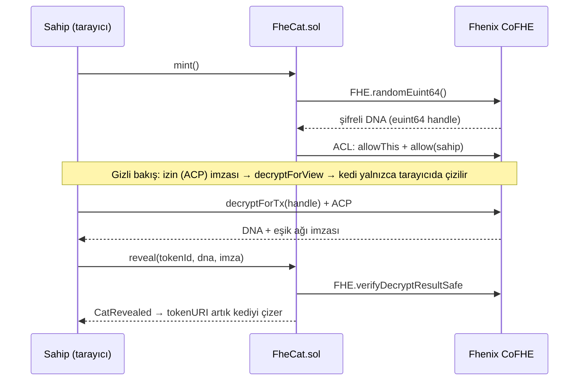

<p align="center">
  
</p>

# FheCat 🐾

**Şifreli doğan piksel kediler.** Fhenix CoFHE üzerinde çalışan bir NFT koleksiyonu. X: [@FheCat](https://x.com/FheCat)

Her FheCat, mint anında DNA'sını Fhenix'in **FHE (tam homomorfik şifreleme) rastgeleliğinden** alır. DNA zincirde yalnızca şifreli (ciphertext) olarak durur. Kedinin özelliklerini reveal edilene kadar kimse bilemez: ne ekip, ne mintleyen kişi, ne de botlar. Kediyi yalnızca sahibi, kendi tarayıcısında gizlice görebilir. Sahibi hazır olduğunda Fhenix eşik ağının (threshold network) imzalı şifre çözme kanıtıyla kediyi zincirde reveal eder. Görseller ve metadata **tamamen zincir üzerinde** üretilir.

<p align="center"></p>

- [Nasıl çalışır](#nasıl-çalışır)
- [Koleksiyon](#koleksiyon)
- [Ağlar](#ağlar)
- [Hızlı başlangıç (yerel)](#hızlı-başlangıç-yerel)
- [Testnet'e yayınlama](#testnete-yayınlama)
- [Yönetim komutları](#yönetim-komutları)
- [Mint sitesini yayınlama](#mint-sitesini-yayınlama)
- [Güvenlik notları ve sınırlamalar](#güvenlik-notları-ve-sınırlamalar)
- [Proje yapısı](#proje-yapısı)
- [English summary](#english-summary)

## Nasıl çalışır



1. **Kör mint.** `mint()` her kedi için `FHE.randomEuint64()` çağırır. Kontrat ve kedinin sahibi şifreli verinin erişim listesine (ACL) eklenir. Nadirlik avcılığı yapılamaz, çünkü özellikler mint anında kimse tarafından bilinemez.
2. **Gizli bakış.** Sahip ücretsiz bir EIP-712 izni (ACP) imzalar. DNA, `decryptForView` ile yalnızca onun tarayıcısında çözülür ve hiçbir yere yayınlanmaz. Kedi el değiştirdiğinde yeni sahip de ACL'e eklenir.
3. **Reveal.** Eşik ağı DNA'yı çözer ve imzalar. `reveal()` bu imzayı `FHE.verifyDecryptResultSafe` ile doğrular. Kontrat sahte bir DNA'yı kabul etmez; başka kedinin kanıtını da reddeder.
4. **Büyük reveal.** Ekip `grandRevealAt` zamanını ayarlar. Bu zamandan sonra herkes gizli kalan kedilerin şifresini herkese açabilir (`FHE.allowPublic`) ve reveal edebilir. `fhecat:reveal-all` komutu bunu toplu olarak yapar.

Sahip de istediği zaman `enablePublicDecryption()` ile kendi kedisini herkese açabilir. Site, izinle şifre çözme başarısız olursa bu yola otomatik olarak geçer.

## Koleksiyon

- **8 özellik, 67 seçenek:** Arka plan, Kürk, Desen, Gözler, Ağız, Başlık, Aksesuar, Aura.
- DNA 64 bittir ve her bayt bir özelliği seçer. Nadirlik ağırlıkları herkese açıktır ve kontratta sabittir (her tablo 256'ya tamamlanır). Tablolar [`art/src/traits.ts`](art/src/traits.ts) dosyasında.
- En nadir seçenekler: Encrypted Aura (%0,8), Gold kürk (%2,3), Cipher Crown (%2,3), 3D Glasses (%3,1).
- 32×32 piksel SVG görseller `FheCatRenderer` kontratında zincir üzerinde çizilir. Web sitesi de aynı çizimi TypeScript'te yapar; testler iki çıktının **bayt bayt aynı** olduğunu doğrular. Böylece gizli bakışta DNA tarayıcıdan hiç çıkmaz.
- Reveal edilmemiş kediler logo motifini ve kendi şifreli handle'ından türetilen bir "barkod" gösterir. Böylece her gizli kedi farklı görünür ama hiçbir şey sızdırmaz.
- Varsayılan ayarlar (`.env` ile değiştirilebilir): arz 3333, testnet'te ücretsiz mint, cüzdan başına 3 (allowlist'te 2), %5 royalty (ERC-2981).

Sanatı değiştirmek için: `art/src/sprites/*` dosyalarını düzenleyin, ardından `cd contracts && npm run art:sol` ile zincir üstü veri kütüphanesini yeniden üretin. `npm run art:preview` komutu `art/preview/index.html` dosyasına örnek bir galeri yazar.

## Ağlar

Fhenix CoFHE bugün (Eylül 2026) şu **testnet'lerde** çalışıyor; henüz mainnet yok:

| Ağ | Chain ID | Hardhat ağı |
|---|---|---|
| Arbitrum Sepolia (varsayılan) | 421614 | `arb-sepolia` |
| Base Sepolia | 84532 | `base-sepolia` |
| Ethereum Sepolia | 11155111 | `eth-sepolia` |

Kontrat, bu üç ağın fork'unda gerçek CoFHE TaskManager ve ACL'e karşı test edildi (`npm run test:fork`). Ölçülen gas değerleri: tek mint ≈191k, üçlü mint ≈483k, transfer ≈109k. FHE işlemi zincir dışında yapıldığı için ek bir FHE ücreti ödenmez.

## Hızlı başlangıç (yerel)

Gereksinim: Node.js 20+ (22 önerilir).

```bash
cd contracts && npm install && npm test   # 35 test: mint, ACL, reveal, metadata, TS↔Solidity render birebirliği
cd ../web && npm install
bash e2e/stack.sh                          # Hardhat + CoFHE mock'ları + yerel deploy + site
# http://localhost:5173 → "Cüzdan bağla" → "Geliştirici cüzdanı"
```

- `npm run test:e2e` (web klasöründe): aynı yığını kurar ve tarayıcıda mint → gizli bakış → reveal akışını test eder.
- `npm run test:fork` (contracts klasöründe): üretim kontratını canlı bir testnet'in fork'unda çalıştırır. Farklı bir ağ için başına `FORK=base-sepolia` ekleyin.

> **Not:** CoFHE mock'ları (0.7.x) şifreli rastgele sayı üretemiyor. Bu yüzden yerel zincirde `FheCatLocal` deploy edilir. Bu varyant rastgeleliği mock'lanabilir bir FHE işlemiyle taklit eder, geri kalan her kod yolu üretimdekiyle aynıdır. Gerçek `FHE.randomEuint64()` yolu fork testinde doğrulanır. `FheCatLocal` 31337 dışındaki bir zincire deploy edilemez.

## Testnet'e yayınlama

1. Yeni bir cüzdan oluşturun ve testnet ETH alın (ör. [Arbitrum Sepolia faucet](https://www.alchemy.com/faucets/arbitrum-sepolia)).
2. Ayarları hazırlayın:
   ```bash
   cd contracts
   cp .env.example .env    # PRIVATE_KEY ve koleksiyon ayarlarını doldurun
   ```
3. Deploy edin:
   ```bash
   npm run deploy:arb-sepolia    # veya deploy:base-sepolia / deploy:eth-sepolia
   ```
   - Adresler `contracts/deployments/<ağ>.json` ve `web/src/config/deployments.json` dosyalarına yazılır. Site bu dosyaları otomatik okur.
   - `ETHERSCAN_API_KEY` ayarlıysa kaynak kod doğrulaması da yapılır.
   - `OWNER_ADDRESS` ayarladıysanız, o adresin `acceptOwnership()` çağırması gerekir (Ownable2Step).
4. Satışı açın:
   ```bash
   npx hardhat fhecat:phase public --network arb-sepolia
   ```
5. `web/src/config/deployments.json` dosyasını commit'leyip siteyi yayınlayın.

## Yönetim komutları

Tüm komutlar `contracts/` klasöründe, `--network <ağ>` ile çalıştırılır.

| Komut | Ne yapar |
|---|---|
| `fhecat:status` | Faz, arz, fiyatlar, limitler, büyük reveal zamanı ve bakiyeyi gösterir |
| `fhecat:phase closed\|allowlist\|public` | Satış fazını değiştirir |
| `fhecat:prices --public 0.001 --allowlist 0` | Mint fiyatlarını ETH cinsinden ayarlar |
| `fhecat:limits --public 3 --allowlist 2` | Cüzdan başına limitleri ayarlar (0 = limitsiz) |
| `fhecat:allowlist adresler.txt` | Merkle kökünü ayarlar ve `web/public/allowlist.json` dosyasını yazar |
| `fhecat:airdrop --to 0x… --quantity 5` | Ekip rezervinden mintler (çağrı başına en fazla 10) |
| `fhecat:grand-reveal 2026-12-31T18:00:00Z` | Büyük reveal zamanını ayarlar (`now` veya `off` da olur) |
| `fhecat:reveal-all --batch 10` | Büyük reveal'dan sonra gizli kalan tüm kedileri açar ve reveal eder |
| `fhecat:peek 12` / `fhecat:reveal 12` | Sahip olduğunuz bir kediye gizlice bakar / onu reveal eder |
| `fhecat:withdraw --to 0x…` | Mint gelirini çeker |

## Mint sitesini yayınlama

`web/` klasörü statik bir Vite + React sitesidir. Cüzdan bağlantısı wagmi ile, şifre çözme `@cofhe/sdk/web` ile yapılır.

```bash
cd web && npm run build    # çıktı: web/dist
```

`dist/` klasörü Vercel, Netlify, Cloudflare Pages veya GitHub Pages'e olduğu gibi yüklenebilir. Birden fazla ağda deploy varsa `VITE_DEFAULT_CHAIN_ID` hangi ağın önce gösterileceğini belirler. Site TR/EN dillerini destekler ve fontları kendi sunar. Analitik veya takip kodu yoktur; dışarıya yalnızca zincirin RPC'sine ve şifre çözme sırasında Fhenix servislerine istek gider. Kontrat deploy edilmeden önce "çok yakında" görünümüyle açılır.

## Güvenlik notları ve sınırlamalar

- **Denetimden geçmedi.** Kontratlar test ediliyor ama bağımsız bir güvenlik denetimi yapılmadı. Mainnet'e çıkmadan önce denetim yaptırın.
- **Ekibin yetkileri:** Ekip DNA'ları çözemez; ACL'de yalnızca kontrat ve sahipler vardır. Ancak `grandRevealAt` ile gizli kedilerin herkese açılma zamanını ekip belirler. Ekip ayrıca renderer'ı değiştirebilir (görseli etkiler, DNA'yı etkilemez). Kontrat yükseltilemez.
- **ACL izinleri kalıcıdır:** Bir kedi satıldığında önceki sahip de DNA'yı çözebilir. Bu, o kişinin zaten bildiği bir bilgidir.
- **Reveal edilmemiş kedi satışı:** Satıcı kedinin özelliklerini bilir, alıcı bilmez. Alıcılar satın almadan önce reveal isteyebilir.
- **İkizler mümkündür:** DNA gerçekten rastgele olduğu için 3333 kedide yaklaşık 5 çift ikiz beklenir.
- **Şifreli girdiler:** CoFHE'nin `encryptInputs` akışı şu an public testnet'lerde çalışmıyor. FheCat bunu kullanmaz; yalnızca zincir üstü rastgelelik ve şifre çözme kullanır.
- **Test ağı tokenlerinin parasal değeri yoktur.**

## Proje yapısı

```
art/         Sprite'lar, özellik/nadirlik tabloları ve TypeScript SVG render'ı (tek doğruluk kaynağı)
contracts/   Hardhat: FheCat.sol, FheCatRenderer.sol, üretilen FheCatArt.sol, testler, deploy ve yönetim komutları
web/         Mint sitesi: Vite + React 19 + wagmi 3 + @cofhe/sdk 0.7, Playwright E2E
docs/        README görselleri
```

Kullanılan sürümler: `@fhenixprotocol/cofhe-contracts` 0.2.0, `@cofhe/sdk` / `@cofhe/hardhat-plugin` 0.7.1, OpenZeppelin 5.4, Solidity 0.8.28 (cancun).

---

## English summary

**FheCat** is a pixel-cat NFT collection on **Fhenix CoFHE**. Each cat's 64-bit DNA comes from `FHE.randomEuint64()` at mint and lives on-chain only as a ciphertext:

- Traits are unknowable at mint time, so nobody can snipe rarity. That includes the team.
- The holder is on the ciphertext's ACL. They can peek privately with `decryptForView` after signing a free EIP-712 permit (ACP).
- The holder reveals by submitting the threshold network's signed decryption. The contract checks it with `FHE.verifyDecryptResultSafe`.
- After the team's grand-reveal time, anyone can open and reveal the remaining cats.

Art and metadata are rendered fully on-chain by `FheCatRenderer`. The site renders them with an identical TypeScript renderer; tests enforce byte-for-byte parity, so a private peek never leaves the browser.

**Testing:**
- **Contracts:** 35 Hardhat tests against the CoFHE mocks.
- **Fork test:** runs the production contract against the live TaskManager/ACL on Arbitrum Sepolia, Base Sepolia and Ethereum Sepolia.
- **End to end:** a Playwright test covers the site's mint → peek → reveal flow.

**Deploy:** `cd contracts && cp .env.example .env && npm run deploy:arb-sepolia`, then `npx hardhat fhecat:phase public --network arb-sepolia`. The site is a static Vite build (`cd web && npm run build`).

**Caveat:** unaudited, testnet only.
